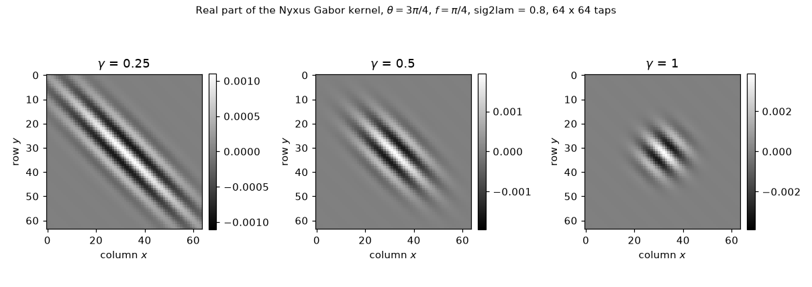

Gabor features
==============

The Gabor feature filters a ROI with a bank of oriented Gabor filters, each tuned to one frequency
and one orientation. For each filter it counts the pixels whose response is strong compared with a
smooth, low-pass baseline, and divides by the number of pixels the baseline itself picks out. The
result is one score per filter, which describes how much of the ROI responds to that frequency and
orientation.

.. list-table::
   :widths: 26 74

   * - **Feature codes**
     - ``GABOR``: one feature with one column per filter, ``GABOR_0`` to ``GABOR_N-1``
   * - **Group**
     - No group of its own; request it by its code, ``GABOR``. ``*ALL*`` and ``*WHOLESLIDE*``
       include it. ``*ALL_BUT_GABOR*`` is listed as a group name but is rejected when used (see
       :doc:`/featuregroups`).
   * - **Dimensions**
     - 2D only. There is no 3D Gabor feature, and in 3D the Gabor options are rejected.
   * - **GPU**
     - Command line only. In a GPU build run with ``--useGpu=true``, the filters of the ROIs
       processed in memory are applied on the GPU; out-of-core ROIs and whole slides use the CPU.
       The Python package never builds the GPU filter bank, so do not use the GPU for ``GABOR``
       from Python. The GPU values are not checked against the CPU values (see
       :ref:`gabor-possible-issues`).
   * - **Out-of-core**
     - Yes, with the same values as in memory on an image that Nyxus reads as one tile. On other
       images out-of-core processing of this family raises an error or returns wrong values,
       depending on the ROI (see :ref:`large-images-tiles`).
   * - **IBSI**
     - No identifier. IBSI defines no Gabor feature; its image-feature chapter names Gabor filters
       only as an image transformation.

.. tip::

   The Python package and the command line start from different filter pairs. To get the same
   columns from both, give the frequencies and orientations explicitly, for example
   ``--gaborfreqs=4,16,32,64 --gabortheta=0,45,90,135`` on the command line, which is the Python
   default (see :ref:`gabor-settings`).

How the features are computed
-----------------------------

Nyxus takes the ROI's bounding box as an image :math:`I`, of :math:`H` rows and :math:`W` columns.
ROI pixels keep their intensity; bounding-box pixels outside the mask are 0. It builds one complex
Gabor kernel per configured pair of frequency :math:`f_k` and orientation :math:`\theta_k`, plus a
low-pass baseline kernel, convolves :math:`I` with each, and takes the magnitude of the result.
Each column is a ratio of two pixel counts made on these response images.

- **Which pixels:** every pixel of the bounding box, inside the mask or not, is filtered and
  counted. Outside the bounding box the image is taken as 0.
- **Filters:** the pairs are used one to one: column ``GABOR_k`` uses frequency :math:`f_k` with
  orientation :math:`\theta_k`. The frequency and orientation lists are not combined into a grid,
  and they must have the same length.
- **Baseline:** one more kernel, at frequency :math:`f_{LP}` (``--gaborf0``, 0.1) and a fixed
  orientation of :math:`\pi/2`, gives the baseline response :math:`R_0`. Its maximum sets the scale
  of the threshold, and its pixel count is the denominator.
- **Values:** a column is the number of bounding-box pixels whose response exceeds
  :math:`T` times the baseline maximum, divided by the number of bounding-box pixels whose baseline
  response exceeds the baseline minimum. It is a ratio of counts, so it has no units, and it can
  exceed 1.
- **Intensity domain:** the filters run on the grey levels Nyxus stores, without binning; see
  :ref:`intensity-units`. Multiplying every intensity by a constant leaves the values unchanged,
  but adding a constant changes them, because the pixels outside the mask and outside the bounding
  box stay 0.
- **IBSI mode:** ``--ibsi=true`` has no effect on ``GABOR``.

Kernels
^^^^^^^

For a filter of frequency :math:`f` and orientation :math:`\theta`, the wavelength is
:math:`\lambda = 2\pi / f` pixels and the width of the Gaussian envelope is
:math:`\sigma = \textrm{sig2lam} \cdot \lambda`. The kernel has :math:`n \times n` taps, at column
offsets :math:`u` and row offsets :math:`v` from :math:`-\lfloor n/2 \rfloor` to
:math:`n - 1 - \lfloor n/2 \rfloor`. Rows run downward. Each tap is

.. math::

   x' = u\cos\theta + v\sin\theta, \qquad y' = v\cos\theta - u\sin\theta

.. math::

   g(u, v) = \exp\!\left(-\frac{x'^2 + \gamma^2 y'^2}{2\sigma^2}\right) e^{\,i f x'},
   \qquad h(u, v) = \frac{g(u, v)}{\sum_{u,v} |g(u, v)|}

The carrier :math:`e^{ifx'}` oscillates along :math:`x'`, so :math:`\theta = 0` responds to
intensity that changes along a row, as in vertical stripes, and :math:`\theta = 90°` to horizontal
stripes. The envelope has width :math:`\sigma` across the stripes and :math:`\sigma/\gamma` along
them; with the default :math:`\gamma = 0.1` it is ten times longer along the stripes. The phase
offset is always 0. The kernel is normalised so that the magnitudes of its taps sum to 1. The
response magnitude does not change when :math:`\theta` changes by 180°.

   Real part of the kernel above, computed as Nyxus computes it, at :math:`\theta = 3\pi/4` and
   :math:`f = \pi/4` with ``sig2lam`` 0.8 on 64 × 64 taps, for three values of :math:`\gamma`;
   rows run downward. Smaller :math:`\gamma` stretches the envelope along the stripes. The
   defaults are 16 × 16 taps and :math:`\gamma = 0.1`.

A frequency of 0 gives an infinite wavelength: the envelope and the carrier are both 1, and the
kernel is a flat :math:`n \times n` window, each tap :math:`1/n^2`.

Response and score
^^^^^^^^^^^^^^^^^^

The response of filter :math:`k` is the magnitude of the full 2D convolution of :math:`I` with
:math:`h_k`, read at an offset of :math:`\lceil n/2 \rceil`:

.. math::

   R_k(y, x) = \left| \sum_{u,v} I(y + s - v,\; x + s - u)\, h_k(u, v) \right|,
   \qquad s = \lceil n/2 \rceil - \lfloor n/2 \rfloor

for :math:`0 \le y < H`, :math:`0 \le x < W`, with :math:`I = 0` outside the bounding box. For an
even kernel size :math:`s = 0` and the response is centred on each pixel. For an odd size
:math:`s = 1` and the response image is shifted by one pixel down and right (see
:ref:`gabor-possible-issues`).

With :math:`R_0` the baseline response, :math:`M = \max R_0` and :math:`m = \min R_0` over the
bounding box,

.. math::

   \mathrm{GABOR\_}k = \frac{\#\{(y, x) : R_k(y, x) / M > T\}}{\#\{(y, x) : R_0(y, x) > m\}}

Two cases skip the formula:

- When every ROI pixel has the same intensity, every column is 0.
- When the baseline response is the same at every pixel (:math:`M = m`), every column is the
  ``--noval`` substitute, 0 by default.

Worked example
^^^^^^^^^^^^^^

Take the 5 × 5 image of the texture pages and leave its four corners out of the mask, so the
bounding box holds 21 ROI pixels and 4 pixels of value 0:

.. math::

   \textbf{I} = \begin{bmatrix}
   0 & 2 & 5 & 4 & 0\\
   3 & 3 & 3 & 1 & 3\\
   2 & 1 & 1 & 1 & 3\\
   4 & 2 & 2 & 2 & 3\\
   0 & 5 & 3 & 3 & 0 \end{bmatrix}

The settings are the Python defaults: :math:`n = 16`, :math:`\gamma = 0.1`, sig2lam 0.8,
:math:`f_{LP} = 0.1`, :math:`T = 0.025`, and the pairs :math:`(4, 0°)`, :math:`(16, 45°)`,
:math:`(32, 90°)` and :math:`(64, 135°)`.

The baseline wavelength is :math:`2\pi/0.1 = 62.8` pixels, so the 16 × 16 baseline kernel is close
to a flat window of weight :math:`1/256`. Every one of its windows covers the whole ROI, and the
baseline response is close to the ROI's sum over 256, :math:`56/256 = 0.21875`, everywhere:
:math:`R_0` runs from :math:`m = 0.21720` to :math:`M = 0.21737`. Only the bottom-right pixel takes
the minimum, so the denominator is 24. The threshold is
:math:`T \cdot M = 0.025 \times 0.21737 = 0.005434`.

The four high-pass responses are far larger. In the first three filters all 25 pixels exceed the
threshold, which gives :math:`25/24 = 1.0417`. The fourth kernel, at :math:`f = 64` and 135°, is
almost a line of five taps along the diagonal from top left to bottom right. For the top-right and
bottom-left corners that diagonal holds only the corner itself, which is 0, so their responses are
about :math:`10^{-17}` and they are not counted: :math:`23/24 = 0.9583`.

.. math::

   \mathrm{GABOR\_0} = \mathrm{GABOR\_1} = \mathrm{GABOR\_2} = \frac{25}{24} = 1.0417,
   \qquad \mathrm{GABOR\_3} = \frac{23}{24} = 0.9583

The *Example* value in the :ref:`index <gabor-index>` is ``GABOR_0``. The test suite runs this
example and checks all four columns.

.. tab-set::

   .. tab-item:: Python

      .. literalinclude:: ../../examples/gabor_worked_example.py
         :language: python
         :start-after: # example-start
         :end-before: # example-end

   .. tab-item:: Command line

      .. code-block:: console

         $ nyxus --features=GABOR --gaborfreqs=4,16,32,64 --gabortheta=0,45,90,135 \
                 --intDir=int/ --segDir=seg/ --outDir=out/ --outputType=singlecsv

Notation
--------

.. list-table::
   :widths: 25 75
   :header-rows: 1

   * - Symbol
     - Meaning
   * - :math:`I(y, x)`
     - The ROI's bounding-box image: the intensity of ROI pixels, 0 elsewhere. :math:`H` rows,
       :math:`W` columns.
   * - :math:`f_k,\; \theta_k`
     - Frequency, in radians per pixel, and orientation, in radians, of filter :math:`k`. The
       orientation is given in degrees and converted.
   * - :math:`\lambda,\; \sigma`
     - Wavelength :math:`2\pi/f` and envelope width :math:`\textrm{sig2lam} \cdot \lambda`, both in
       pixels.
   * - :math:`\gamma`
     - Aspect ratio of the envelope (``--gaborgamma``).
   * - :math:`n`
     - Kernel size in pixels (``--gaborkersize``).
   * - :math:`u,\; v`
     - Column and row offset of a kernel tap.
   * - :math:`h_k`
     - Kernel of filter :math:`k`, normalised so that its tap magnitudes sum to 1.
   * - :math:`R_k,\; R_0`
     - Response magnitude of filter :math:`k`, and of the baseline filter.
   * - :math:`f_{LP}`
     - Frequency of the baseline filter (``--gaborf0``); its orientation is :math:`\pi/2`.
   * - :math:`M,\; m`
     - Largest and smallest baseline response over the bounding box.
   * - :math:`T`
     - Threshold on :math:`R_k / M` (``--gaborthold``).

Counts :math:`\#\{\cdot\}` run over the :math:`H \times W` pixels of the bounding box.

.. _gabor-settings:

Settings
--------

.. list-table::
   :widths: 16 28 26 30
   :header-rows: 1

   * - Setting
     - Command line
     - Python
     - Effect
   * - Frequencies
     - ``--gaborfreqs``
     - ``Nyxus(..., gabor_freqs=[4, 16, 32, 64])``
     - :math:`f_k` in radians per pixel; the wavelength is :math:`2\pi/f_k` pixels. One column per
       value. Any real number is accepted, 0 included.
   * - Orientations
     - ``--gabortheta``
     - ``Nyxus(..., gabor_thetas=[0, 45, 90, 135])``
     - :math:`\theta_k` in degrees, paired one to one with the frequencies. No range check.
   * - Envelope aspect ratio
     - ``--gaborgamma=0.1``
     - ``Nyxus(..., gabor_gamma=0.1)``
     - :math:`\gamma`; must be positive.
   * - Bandwidth
     - ``--gaborsig2lam=0.8``
     - ``Nyxus(..., gabor_sig2lam=0.8)``
     - :math:`\sigma/\lambda`; must be positive.
   * - Kernel size
     - ``--gaborkersize=16``
     - ``Nyxus(..., gabor_kersize=16)``
     - :math:`n`; a positive integer. An odd size shifts the response by one pixel.
   * - Baseline frequency
     - ``--gaborf0=0.1``
     - ``Nyxus(..., gabor_f0=0.1)``
     - :math:`f_{LP}`, in the same units as the frequencies; must be positive.
   * - Threshold
     - ``--gaborthold=0.025``
     - ``Nyxus(..., gabor_thold=0.025)``
     - :math:`T`. Any real number; at :math:`T < 0` every pixel is counted.

The frequency and orientation lists go together: give both or neither, with the same number of
values, or the run stops with an error. Without them the command line uses its built-in pairs,
frequencies :math:`0, \pi/4, \pi/2, 3\pi/4` at orientations of 4, 16, 32 and 64 *radians*, which act
as 49.2°, 16.7°, 33.5° and 66.9°. The Python package always passes its own defaults, frequencies 4,
16, 32 and 64 at 0°, 45°, 90° and 135°, so a Python run never uses the built-in pairs. Every value is
read as a single-precision number, so ``gabor_gamma=0.1`` is used as 0.100000001.

In Python, ``Nyxus.set_gabor_feature_params(kersize=, gamma=, sig2lam=, f0=, thold=, thetas=,
freqs=)`` and ``Nyxus.set_params(gabor_...=)`` change the settings after construction; settings not
named keep their value. ``--coarseGrayDepth`` and ``--ibsi`` have no effect on ``GABOR``. All options
are listed in the :ref:`cli-reference`.

Output columns
--------------

``GABOR`` produces one column per frequency and orientation pair, ``GABOR_0`` to ``GABOR_N-1``, in
the order the pairs are given. With the Python defaults there are four: ``GABOR_0`` is
:math:`(4, 0°)`, ``GABOR_1`` :math:`(16, 45°)`, ``GABOR_2`` :math:`(32, 90°)` and ``GABOR_3``
:math:`(64, 135°)`. The column names carry only the index; the frequencies and orientations are not
written to the output. In Python, ``Nyxus.get_params()`` returns them as ``gabor_freqs`` and
``gabor_thetas``. There is no ``_AVE`` column.

.. _gabor-index:

Feature index
-------------

*Validation* names the independent implementation each feature is checked against in the test
suite, with the relative tolerance; see the :doc:`/featurelist` for what the categories mean.
*Example* is the value of ``GABOR_0`` on the worked example.

.. include:: gabor_index.inc

Features
--------

.. _feature-gabor:

Gabor filter-bank score
^^^^^^^^^^^^^^^^^^^^^^^

:Code: ``GABOR`` (columns ``GABOR_0`` to ``GABOR_N-1``)
:Range: :math:`[0, H W]` per column, dimensionless; usually close to 1

For each filter, the number of bounding-box pixels whose response exceeds :math:`T` times the
largest baseline response, divided by the number of bounding-box pixels whose baseline response
exceeds its smallest value. High values mean the filter responds over much of the bounding box;
low values mean the response is strong only in part of it.

.. math::

   \mathrm{GABOR\_}k = \frac{\#\{(y, x) : R_k(y, x) / M > T\}}{\#\{(y, x) : R_0(y, x) > m\}}

The value is 0 for every column when the ROI has a single intensity, and the ``--noval``
substitute when the baseline response is constant.

**Possible issues.** The numerator counts every pixel of the bounding box, while the denominator
leaves out the pixels where the baseline takes its minimum, so a value can exceed 1. A 1 × 2 ROI of
intensities 3 and 8 gives 2 in every column. See :ref:`gabor-possible-issues` for the default
frequencies and the other conventions.

.. _gabor-possible-issues:

Possible issues
---------------

Different default pairs on the command line and in Python
   Without ``--gaborfreqs`` and ``--gabortheta``, the command line pairs frequencies
   :math:`0, \pi/4, \pi/2, 3\pi/4` with orientations of 4, 16, 32 and 64 radians: the built-in list
   stores each frequency where an orientation belongs, and the reverse. Python uses frequencies 4,
   16, 32, 64 at 0°, 45°, 90°, 135°. The same image gives different ``GABOR`` columns from the two
   unless both lists are given.

Frequencies are in radians per pixel
   The command-line help describes ``--gaborfreqs`` and ``--gaborf0`` as "denominators of
   :math:`\pi`", but the code uses each value as :math:`f` in :math:`\lambda = 2\pi/f`, as the
   Python docstrings say. The Python
   defaults 4, 16, 32 and 64 are therefore wavelengths of 1.57, 0.39, 0.20 and 0.10 pixels, all
   shorter than the 2-pixel limit a pixel grid can represent, with envelope widths of 1.26 down to
   0.08 pixels. The last three kernels shrink to a short line of a few taps and respond to almost
   any intensity. On 24 × 24 stripes with a period of 4 pixels, the defaults give 1.0017 in every
   column for vertical stripes, and 0.16696, 1.0017, 1.0017, 1.0017 for horizontal ones: only
   ``GABOR_0`` tells them apart. Two filters at :math:`f = \pi/2` (a 4-pixel wavelength) and 0° and
   90° give 1.0017 and 0.38957 for vertical stripes and the reverse for horizontal ones; with
   ``--gaborthold=0.3`` they give 0.65913 and 0.

The baseline is close to a ROI average
   With the default :math:`f_{LP} = 0.1` the baseline kernel is nearly a flat 16 × 16 window, so
   :math:`M` is about the mean intensity of the 16 × 16 window, zeros included. On small ROIs it is
   much smaller than the high-pass responses, and with :math:`T = 0.025` almost every pixel passes
   the threshold: on the worked example the threshold is 0.0054, and the smallest response of the
   first three filters is 0.012. Most values then lie near 1, and differences between ROIs come
   from a few pixels.

Pixels outside the mask take part
   The pixels of the bounding box outside the mask are filtered and counted as 0, and the image is
   0 beyond the bounding box. The same ROI therefore gives different values in a different mask
   shape, and adding a constant to every intensity changes the values: on the worked example,
   adding 100 changes ``GABOR_0`` from 1.0417 to 0.8333. Multiplying every intensity by a constant
   changes nothing.

Odd kernel sizes shift the response
   The response is read from the full convolution at an offset of :math:`\lceil n/2 \rceil`, while
   the kernel's centre tap is at :math:`\lfloor n/2 \rfloor`. For odd :math:`n` the response image
   is shifted by one pixel down and right. With
   ``--gaborkersize=15`` the worked example gives 1.0417, 0.9167, 0.8333, 0.9167; a centred
   response would give 1.0417, 1.0417, 1.0417, 0.9583.

Settings are shared by all ``Nyxus`` objects in a process
   The Gabor settings are held once per process, not per object, and every ``Nyxus`` constructor
   sets all of them. An object built with ``gabor_freqs=[1.5708, 1.5708]``,
   ``gabor_thetas=[0, 90]`` returns two columns until a second ``Nyxus()`` is constructed; from
   then on the first object also returns the four default columns.

GPU values
   The GPU path, used only from the command line, builds the same kernels and computes the linear
   convolution through an FFT. It differs from the CPU path in three ways: it stores the
   responses in single precision, which can move a response across the threshold; it reads the
   response at an offset of :math:`\lfloor n/2 \rfloor`, so odd kernel sizes are centred on the
   GPU and shifted on the CPU; and it has no guard for a constant baseline: where the CPU stores
   the ``--noval`` value, it divides by a count of 0, and the infinite or NaN result is replaced
   at output time (by ``--noval`` in CSV and pandas, by ``-0.0`` in Arrow and Parquet). ROIs
   whose padded image times the number of filters exceeds cuFFT's limit of :math:`2^{27}` values
   are refused. The GPU values are not checked in continuous integration.

Constant ROI
   When every ROI pixel has one intensity, every column is 0, even when the mask leaves zeros in the
   bounding box that would make the responses vary.

Validation
----------

The test suite checks ``GABOR`` against scikit-image 0.26.0 on four DSB2018 nuclei, in bounding
boxes of 90 to 224 pixels, to a relative 10\ :sup:`-3`, at two settings: the command line's built-in
pairs and the Python default pairs. All 32 values agree exactly. scikit-image supplies the kernels:
its ``gabor_kernel`` at frequency :math:`f/2\pi`, cropped to the 16 × 16 grid. The frequency-0
kernel of the built-in pairs is the flat window in closed form, because ``gabor_kernel`` cannot take
a frequency of 0. scikit-image has no equivalent of the count-ratio score, so the score is computed
by the test's own code from the definition above. The check covers the CPU path in memory; the GPU
path is not checked in continuous integration. The ``GABOR`` values quoted in the worked example
and under Possible issues, and the wavelengths and envelope widths, are asserted by the
worked-example script; the intermediate responses (the baseline range, the threshold and the
smallest high-pass response) and the centred-response values for an odd kernel are not. None is
compared with a reference tool.

References
----------

1. Gabor D. *Theory of communication.* Journal of the Institution of Electrical Engineers.
   1946;93(26):429–457.
2. Daugman JG. *Uncertainty relation for resolution in space, spatial frequency, and orientation
   optimized by two-dimensional visual cortical filters.* Journal of the Optical Society of
   America A. 1985;2(7):1160–1169.
3. Orlov N, Shamir L, Macura T, Johnston J, Eckley DM, Goldberg IG. *WND-CHARM: Multi-purpose image
   classification using compound image transforms.* Pattern Recognition Letters.
   2008;29(11):1684–1693. (Origin of the count-ratio Gabor score.)
4. van der Walt S, et al. *scikit-image: image processing in Python.* PeerJ. 2014;2:e453.
