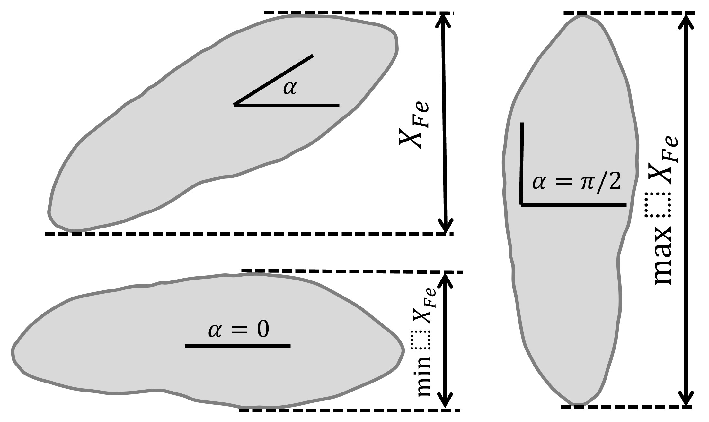
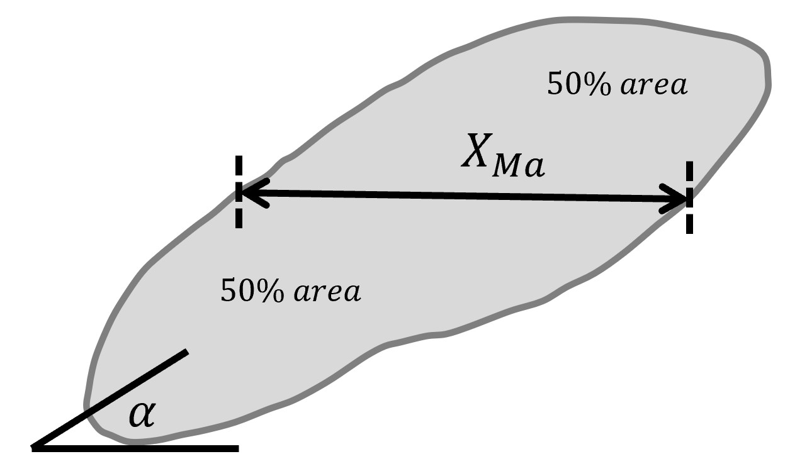
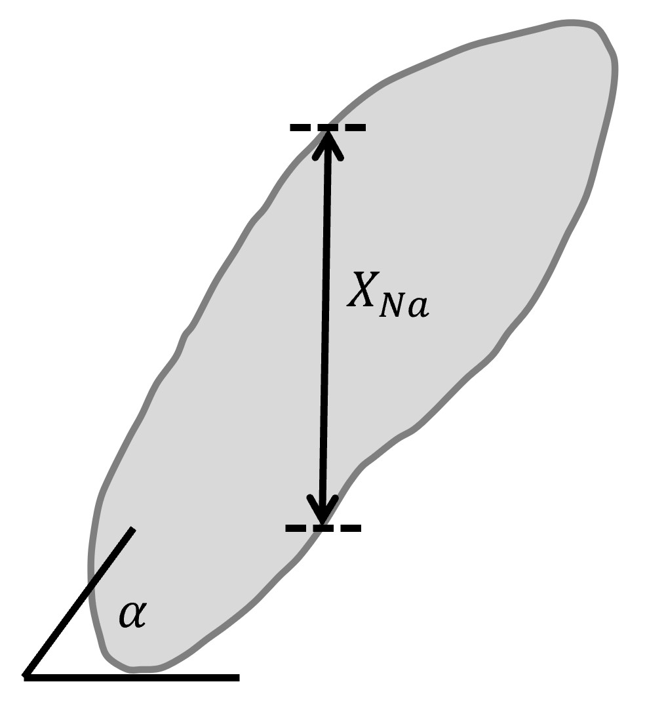
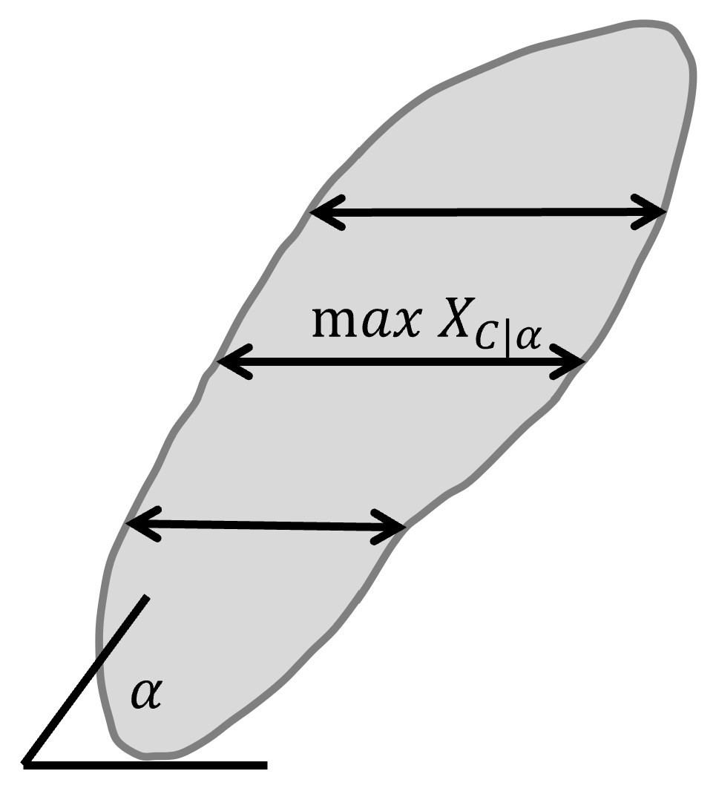

Morphology features
===================

Morphology features describe the shape of a ROI: its size, position, outline, convex hull,
best-fitting ellipse, diameters measured at many angles, and its neighbours. Except for a few
intensity-weighted features, they use only the ROI's mask.

.. list-table::
   :widths: 26 74

   * - **Feature codes**
     - 104 codes in 14 families: basic morphology (15), contour (7), convex hull (6), ellipse
       fitting (6), circles (3), ROI radius (3), extrema (16), Euler number (1), geodetic length
       and thickness (2), Feret (8), Martin (6) and Nassenstein (6) diameters, chords (16) and
       neighbours (9). Every code produces one column.
   * - **Group**
     - ``*ALL_MORPHOLOGY*`` holds all 104, and also the erosion and fractal-dimension families,
       which have their own pages. ``*BASIC_MORPHOLOGY*`` holds the basic morphology family and
       ``*ALL_NEIGHBOR*`` the neighbour family.
   * - **Dimensions**
     - 2D. The 3D shape family, ``3AREA``, ``3VOLUME_CONVEXHULL`` and so on, has its own page,
       :doc:`f_morphology_3d`.
   * - **GPU**
     - No; computed on the CPU in every build.
   * - **Out-of-core**
     - Partly. Out of core the contour is traced as a single loop, so a hole or a second fragment
       is left out of it, which also changes the ``EDGE_*`` features of such ROIs; ``PERIMETER``
       counts the loop's pixels, which changes the features built on it
       (``DIAMETER_EQUAL_PERIMETER``, ``CIRCULARITY``, the geodetic length and thickness), and the
       contour-based circle and radius features use contour coordinates relative to the bounding
       box. The neighbour features are not computed: they are 0, and ``POLYGONALITY_AVE`` and
       ``HEXAGONALITY_*`` are −1. With anisotropy the out-of-core contour is wrong, so every
       contour-based feature can differ. These out-of-core differences are a known defect
       (`#509 <https://github.com/PolusAI/nyxus/issues/509>`__). See :ref:`morphology-possible-issues`,
       :doc:`/large_images` and :ref:`large-images-tiles`.
   * - **IBSI**
     - None. IBSI defines morphological features in 3D only (DHQ4), so no 2D code on this page
       has an identifier.

.. tip::

   Coordinates are in pixels with the origin at the top-left pixel of the image, :math:`x` along
   the columns and :math:`y` down the rows. Angles therefore turn from the :math:`x` axis towards
   the bottom of the image, which is clockwise on screen. Neighbour features need several ROIs in
   one image: request ``*ALL_NEIGHBOR*`` or the codes together with the other ROIs' masks.

How the features are computed
-----------------------------

Each family starts from one of four sets derived from the ROI's mask:

- **Pixels:** every pixel of the mask with the ROI's label, at its integer position
  :math:`(x_k, y_k)`. :math:`N` is their number. The basic morphology, ellipse, extrema, Euler and
  chord families use them.
- **Contour:** the ROI's boundary, traced on the mask: the ROI pixels that have a 4-neighbour
  outside the ROI. :math:`M` is their number. They are walked border by border, once around the
  outside of each separate part of the ROI and once around each hole. The contour, perimeter,
  circle, ROI radius, neighbour and polygonality features use it.
- **Convex hull:** the convex polygon spanned by the pixel centres. The convex hull and the three
  caliper families use it.
- **Other ROIs:** the neighbour family compares the ROI's contour and centroid with those of the
  other ROIs in the same image.

The values are:

- **Units:** lengths in pixels, areas in pixels, angles in degrees, except the chord angles, which
  are in radians.
- **Intensities:** only ``WEIGHTED_CENTROID_X``, ``WEIGHTED_CENTROID_Y``, ``MASS_DISPLACEMENT``,
  the ``EDGE_*`` features and the chords look at intensities. They use the grey levels Nyxus stores,
  not the image's own units (see :ref:`intensity-units`). The chords treat a ROI pixel of grey
  level 0 as a gap.
- **Binning:** none. ``--coarseGrayDepth`` and ``--ibsi`` do not change any morphology feature.
- **Pixel size:** none is applied. ``AREA_UM2`` is meant to convert the area to square micrometres
  and is always 0, a known defect (`#496 <https://github.com/PolusAI/nyxus/issues/496>`__).

Worked example
^^^^^^^^^^^^^^

Take one 17 × 14 image with two ROIs. ROI 1 occupies :math:`x = 1 \dots 12`,
:math:`y = 1 \dots 12`, with a notch three pixels wide cut into its top and its four corners trimmed.
ROI 2 is a 3 × 5 rectangle at :math:`x = 13 \dots 15`, :math:`y = 4 \dots 8`, touching ROI 1's
right side. The mask, with background ``.``:

.. code-block:: text

   .................
   ...111...111.....
   ..1111...1111....
   .11111...1111....
   .11111...1111222.
   .11111...1111222.
   .111111111111222.
   .111111111111222.
   .111111111111222.
   .111111111111....
   .11111111111.....
   ..111111111......
   ...1111111.......
   .................

The grey level of the pixel at :math:`(x, y)` is :math:`1 + (3x + 5y) \bmod 9`.

ROI 1 has :math:`N = 116` pixels, its centroid is :math:`(6.405, 6.75)`, and its bounding box is
12 × 12 at :math:`(1, 1)`, so ``EXTENT`` is :math:`116/144 = 0.8056`. Its contour holds
:math:`M = 44` pixels, joined by 34 axial and 10 diagonal steps, so
``PERIMETER`` :math:`= 34 + 10\sqrt{2} = 48.14`. The convex hull has the eight vertices
:math:`(1,3), (3,1), (11,1), (12,2), (12,9), (9,12), (3,12), (1,10)`: its polygon area is 112 and
36 lattice points lie on its boundary, so ``CONVEX_HULL_AREA`` is :math:`112 + 36/2 + 1 = 131`
and ``SOLIDITY`` is :math:`116/131 = 0.8855`. The moment ellipse has axes 13.91 and 12.55, with
its major axis at −18.77°: it rises to the right on screen.

The Feret diameter at 0° is the hull's width along :math:`x`, :math:`12 - 1 = 11`; the largest,
13.57, is at 50°. ROI 2 is ROI 1's only neighbour: its centroid :math:`(14, 6)` lies 7.632 pixels
away at 354.4°, slightly above the :math:`x` axis. Seven of ROI 1's 44 contour pixels touch ROI 2,
so ``PERCENT_TOUCHING`` is 15.91; for ROI 2 it is 5 of 12, 41.67.

The *Example* value of each feature in the :ref:`index <morphology-index>` is what Nyxus returns
for ROI 1. The test suite runs this example and checks every one of them.

.. tab-set::

   .. tab-item:: Python

      .. literalinclude:: ../../examples/morphology_worked_example.py
         :language: python
         :start-after: # example-start
         :end-before: # example-end

   .. tab-item:: Command line

      .. code-block:: console

         $ nyxus --features="*ALL_MORPHOLOGY*" \
                 --intDir=int/ --segDir=seg/ --outDir=out/ --outputType=singlecsv

Notation
--------

.. list-table::
   :widths: 25 75
   :header-rows: 1

   * - Symbol
     - Meaning
   * - :math:`(x_k, y_k)`
     - Position of the :math:`k`-th ROI pixel: column and row, in pixels.
   * - :math:`I_k`
     - Grey level of the :math:`k`-th ROI pixel.
   * - :math:`N`
     - Number of ROI pixels.
   * - :math:`c_x,\; c_y`
     - Centroid, :math:`c_x = \frac{1}{N}\sum_k x_k` and :math:`c_y = \frac{1}{N}\sum_k y_k`.
   * - :math:`W,\; H`
     - Width and height of the bounding box, :math:`W = \max_k x_k - \min_k x_k + 1` and
       :math:`H = \max_k y_k - \min_k y_k + 1`.
   * - :math:`(u_j, v_j)`
     - Position of the :math:`j`-th contour pixel, :math:`j = 1 \dots M`.
   * - :math:`M`
     - Number of contour pixels.
   * - :math:`(u^b_i, v^b_i)`
     - Position of the :math:`i`-th step of the walk around border :math:`b`,
       :math:`i = 1 \dots L_b`.
   * - :math:`P`
     - ``PERIMETER``.
   * - :math:`A_h`
     - ``CONVEX_HULL_AREA``.
   * - :math:`F_{\min},\; F_{\max}`
     - ``STAT_FERET_DIAM_MIN`` and ``STAT_FERET_DIAM_MAX``.
   * - :math:`n_b`
     - ``NUM_NEIGHBORS``.
   * - :math:`D`
     - The neighbour distance, ``--pixelDistance``.
   * - :math:`\mathrm{sd}_{n-1}(\cdot)`
     - Sample standard deviation with :math:`n - 1`, and 0 for 2 values or fewer.

Sums over :math:`k` run over the ROI pixels and sums over :math:`j` over the contour pixels.

Settings
--------

.. list-table::
   :widths: 16 28 26 30
   :header-rows: 1

   * - Setting
     - Command line
     - Python
     - Effect
   * - Neighbour distance
     - ``--pixelDistance=5``
     - ``Nyxus(..., neighbor_distance=5)``
     - :math:`D`. Two ROIs are neighbours when some pair of their contour pixels lies at most
       :math:`D` pixels apart. It changes ``NUM_NEIGHBORS``, the ``CLOSEST_NEIGHBOR*`` and
       ``ANG_BW_NEIGHBORS_*`` features, and through ``NUM_NEIGHBORS`` the polygonality and
       hexagonality scores. ``PERCENT_TOUCHING`` does not depend on it.
   * - Pixel size
     - ``--pixelsPerCentimeter``
     - ``Nyxus(..., pixels_per_micron=1.0)``
     - No effect: ``AREA_UM2`` is 0 with any value, a known defect (`#496 <https://github.com/PolusAI/nyxus/issues/496>`__).
   * - Anisotropy
     - ``--anisox``, ``--anisoy``
     - ``Nyxus(..., anisotropy_x=1.0, anisotropy_y=1.0)``
     - Images read from files: the geometric features are computed on the ROI resampled by these
       factors, so lengths are in resampled pixels; the ``EDGE_*`` features,
       ``WEIGHTED_CENTROID_*`` and ``MASS_DISPLACEMENT`` use the pixels as acquired, each at its
       position scaled by the factors. Arrays passed
       to ``Nyxus.featurize`` are not resampled. See :ref:`morphology-possible-issues`.
   * - Merged ROIs
     - ``--mergerois=true``
     - ``Nyxus(..., mergerois=True)``
     - All labels of a mask form one ROI. On the worked example it has 131 pixels, a perimeter of
       52.97 and no neighbours.
   * - Memory limit
     - ``--ramLimit``
     - ``Nyxus.set_params(ram_limit=...)``
     - ROIs that do not fit are computed out of core, with the differences listed under
       :ref:`morphology-possible-issues`.

``--coarseGrayDepth`` and ``--ibsi`` have no effect on these features. All options are listed in
the :ref:`cli-reference`.

Output columns
--------------

Each code produces one column, named with its code: ``AREA_PIXELS_COUNT``, ``PERIMETER``,
``EXTREMA_P1_X`` and so on. No code on this page has per-angle columns or ``_AVE`` columns:
``POLYGONALITY_AVE`` and ``HEXAGONALITY_AVE`` are single scores whose names end in ``_AVE``.

When a feature cannot be computed, its column holds a substitute value:

- ``POLYGONALITY_AVE``, ``HEXAGONALITY_AVE`` and ``HEXAGONALITY_STDDEV`` are −1 for a ROI with fewer
  than three neighbours.
- ``CLOSEST_NEIGHBOR2_DIST`` and ``CLOSEST_NEIGHBOR2_ANG`` are 0 for a ROI with fewer than two
  neighbours, and every neighbour feature except ``PERCENT_TOUCHING`` is 0 for a ROI without
  neighbours: with ``--pixelDistance=1`` two ROIs that touch only diagonally are not neighbours
  but still count as touching.
- ``WEIGHTED_CENTROID_X`` and ``WEIGHTED_CENTROID_Y`` are 0 when the ROI's grey levels sum to 0.
- ``PERIMETER`` and the features built on it are 0 for a single pixel, whose contour is the pixel
  itself.

The ellipse, circle and hexagonality codes are right only when the codes they read from are in the
same run, a known defect (`#495 <https://github.com/PolusAI/nyxus/issues/495>`__); see :ref:`morphology-possible-issues`.

.. _morphology-index:

Feature index
-------------

*Validation* names the independent implementation each feature is checked against in the test
suite, with its tolerance; see the :doc:`/featurelist` for what the categories mean.
*Example* is the value on ROI 1 of the worked example.

Basic morphology
^^^^^^^^^^^^^^^^

.. include:: basic_morphology_index.inc

Contour
^^^^^^^

.. include:: contour_index.inc

Convex hull
^^^^^^^^^^^

.. include:: convex_hull_index.inc

Ellipse fitting
^^^^^^^^^^^^^^^

.. include:: ellipse_index.inc

Circles
^^^^^^^

.. include:: circles_index.inc

ROI radius
^^^^^^^^^^

.. include:: roi_radius_index.inc

Extrema
^^^^^^^

.. include:: extrema_index.inc

Euler number
^^^^^^^^^^^^

.. include:: euler_index.inc

Geodetic length and thickness
^^^^^^^^^^^^^^^^^^^^^^^^^^^^^

.. include:: geodetic_index.inc

Feret diameters
^^^^^^^^^^^^^^^

.. include:: feret_index.inc

Martin diameters
^^^^^^^^^^^^^^^^

.. include:: martin_index.inc

Nassenstein diameters
^^^^^^^^^^^^^^^^^^^^^

.. include:: nassenstein_index.inc

Chords
^^^^^^

.. include:: chords_index.inc

Neighbours
^^^^^^^^^^

.. include:: neighbors_index.inc

Features
--------

Basic morphology
^^^^^^^^^^^^^^^^

.. _feature-area-pixels-count:

Area
""""

:Code: ``AREA_PIXELS_COUNT``
:Range: :math:`[1, \infty)`, pixels

The number of ROI pixels, :math:`N`.

.. _feature-area-um2:

Area in square micrometres
""""""""""""""""""""""""""

:Code: ``AREA_UM2``
:Range: always 0

Meant as :math:`N` times the squared pixel size. This is a known defect (`#496 <https://github.com/PolusAI/nyxus/issues/496>`__): the
computation runs
only when the image resolution setting is positive, and nothing sets it, so the value is 0 for
every ROI whatever pixel size is given on the command line or in Python.

.. _feature-centroid-x:
.. _feature-centroid-y:

Centroid
""""""""

:Codes: ``CENTROID_X``, ``CENTROID_Y``
:Range: image coordinates, pixels

The mean position of the ROI's pixels, :math:`c_x` and :math:`c_y`.

.. math::

   \mathrm{CENTROID\_X} = \frac{1}{N}\sum_k x_k, \qquad
   \mathrm{CENTROID\_Y} = \frac{1}{N}\sum_k y_k

.. _feature-weighted-centroid-x:
.. _feature-weighted-centroid-y:

Intensity-weighted centroid
"""""""""""""""""""""""""""

:Codes: ``WEIGHTED_CENTROID_X``, ``WEIGHTED_CENTROID_Y``
:Range: image coordinates, pixels

The mean position of the ROI's pixels, each weighted by its grey level.

.. math::

   \mathrm{WEIGHTED\_CENTROID\_X} = \frac{\sum_k x_k I_k}{\sum_k I_k}, \qquad
   \mathrm{WEIGHTED\_CENTROID\_Y} = \frac{\sum_k y_k I_k}{\sum_k I_k}

Both are 0 when :math:`\sum_k I_k = 0`.

.. _feature-mass-displacement:

Mass displacement
"""""""""""""""""

:Code: ``MASS_DISPLACEMENT``
:Range: :math:`[0, \infty)`, pixels

The distance between the intensity-weighted centroid and the centroid. Large values mean the
bright part of the ROI lies off its centre.

.. math::

   \mathrm{MASS\_DISPLACEMENT} = \sqrt{(\mathrm{WEIGHTED\_CENTROID\_X} - c_x)^2 +
   (\mathrm{WEIGHTED\_CENTROID\_Y} - c_y)^2}

**Possible issues.** For a ROI whose grey levels are all 0 the weighted centroid is
:math:`(0, 0)`, so the value is the distance of the centroid from the image origin: 15.23 for ROI 2
of the worked example with its pixels set to 0.

.. _feature-compactness:

Compactness
"""""""""""

:Code: ``COMPACTNESS``
:Range: :math:`[0, \infty)`, 1/pixel

The spread of the pixels' distances from the centroid, divided by the area.

.. math::

   d_k = \sqrt{(x_k - c_x)^2 + (y_k - c_y)^2}, \qquad
   \mathrm{COMPACTNESS} = \frac{\mathrm{sd}_{n-1}(d_k)}{N}

**Possible issues.** The value is a standard deviation of distances divided by a pixel count, not
a dimensionless shape ratio: it falls as the ROI grows. On the worked example it is 0.01369; the
mean squared distance to the centroid divided by the area, another common definition, is 0.1877.

.. _feature-bbox-xmin:
.. _feature-bbox-ymin:
.. _feature-bbox-width:
.. _feature-bbox-height:

Bounding box
""""""""""""

:Codes: ``BBOX_XMIN``, ``BBOX_YMIN``, ``BBOX_WIDTH``, ``BBOX_HEIGHT``
:Range: image coordinates and :math:`[1, \infty)`, pixels

The smallest axis-aligned box that holds every ROI pixel: its left column, top row, width and
height. Width and height count pixels, so a one-pixel ROI has a 1 × 1 box.

.. math::

   \mathrm{BBOX\_XMIN} = \min_k x_k, \quad \mathrm{BBOX\_YMIN} = \min_k y_k, \quad
   \mathrm{BBOX\_WIDTH} = W, \quad \mathrm{BBOX\_HEIGHT} = H

.. _feature-diameter-equal-area:

Equal-area diameter
"""""""""""""""""""

:Code: ``DIAMETER_EQUAL_AREA``
:Range: :math:`[1.128, \infty)`, pixels

The diameter of the circle with the ROI's area.

.. math::

   \mathrm{DIAMETER\_EQUAL\_AREA} = 2\sqrt{N/\pi}

.. _feature-extent:

Extent
""""""

:Code: ``EXTENT``
:Range: :math:`(0, 1]`, dimensionless

The fraction of the bounding box covered by the ROI.

.. math::

   \mathrm{EXTENT} = \frac{N}{W H}

.. _feature-aspect-ratio:

Aspect ratio
""""""""""""

:Code: ``ASPECT_RATIO``
:Range: :math:`(0, \infty)`, dimensionless

The bounding box's width divided by its height; 0.6 for ROI 2 of the worked example, which is 3
wide and 5 tall.

.. math::

   \mathrm{ASPECT\_RATIO} = \frac{W}{H}

Contour
^^^^^^^

The contour is the ROI's pixels that have a 4-neighbour outside the ROI. Nyxus traces it on the
mask padded by one pixel, by Suzuki and Abe's border following, the algorithm behind OpenCV's
``findContours``: one closed walk of 8-connected steps around the outside of each separate part of
the ROI, and one around each hole. Steps are 1 or :math:`\sqrt{2}` long. A walk passes a part
of the ROI that is one pixel wide twice, once on each side, and two borders can share a pixel; the
contour pixels themselves, :math:`M` of them, are each counted once.

.. _feature-perimeter:

Perimeter
"""""""""

:Code: ``PERIMETER``
:Range: :math:`[0, \infty)`, pixels

The summed length of the closed walks around the ROI's borders, through the contour pixels'
centres.

.. math::

   \mathrm{PERIMETER} = \sum_b \sum_{i=1}^{L_b} \sqrt{(u^b_i - u^b_{i-1})^2 + (v^b_i - v^b_{i-1})^2},
   \qquad (u^b_0, v^b_0) = (u^b_{L_b}, v^b_{L_b})

A 9 × 9 square with a 3 × 3 hole gives 45.66, its outer walk of 32 and the hole's walk of 13.66,
and a label made of two 5 × 4 rectangles gives 28, 14 for each.

**Possible issues.** The path runs through pixel centres, so it is shorter than the outline of the
pixel squares: a 3 × 5 rectangle has a perimeter of 12, not 16. A part one pixel wide is walked
on both sides: a 1 × 13 bar gives 24. Out of core the value is the number of pixels of the first
traced loop, without holes or other fragments: 44 for ROI 1 of the worked example.

.. _feature-diameter-equal-perimeter:

Equal-perimeter diameter
""""""""""""""""""""""""

:Code: ``DIAMETER_EQUAL_PERIMETER``
:Range: :math:`[0, \infty)`, pixels

The diameter of the circle with the ROI's perimeter.

.. math::

   \mathrm{DIAMETER\_EQUAL\_PERIMETER} = \frac{P}{\pi}

.. _feature-edge-mean-intensity:
.. _feature-edge-stddev-intensity:
.. _feature-edge-max-intensity:
.. _feature-edge-min-intensity:
.. _feature-edge-integrated-intensity:

Edge intensities
""""""""""""""""

:Codes: ``EDGE_MEAN_INTENSITY``, ``EDGE_STDDEV_INTENSITY``, ``EDGE_MAX_INTENSITY``,
   ``EDGE_MIN_INTENSITY``, ``EDGE_INTEGRATED_INTENSITY``
:Range: grey levels; :math:`[0, \infty)` for the standard deviation

Statistics of the grey levels :math:`I_j` of the :math:`M` contour pixels: their mean, sample
standard deviation, maximum, minimum and sum.

.. math::

   \mathrm{EDGE\_MEAN\_INTENSITY} = \frac{1}{M}\sum_j I_j, \qquad
   \mathrm{EDGE\_STDDEV\_INTENSITY} = \mathrm{sd}_{n-1}(I_j), \qquad
   \mathrm{EDGE\_INTEGRATED\_INTENSITY} = \sum_j I_j

On the worked example the 44 contour pixels of ROI 1 sum to 228, a mean of 5.182. The values are in
grey levels, not converted to the image's units.

Convex hull
^^^^^^^^^^^

The hull is built from the pixel centres by a monotone chain; points on a hull edge are not
vertices.

.. _feature-convex-hull-area:

Convex hull area
""""""""""""""""

:Code: ``CONVEX_HULL_AREA``
:Range: :math:`[N, \infty)`, pixels

The area of the convex hull, converted with Pick's theorem to the number of pixel centres the
hull covers, so that it is comparable with :math:`N`.

.. math::

   \mathrm{CONVEX\_HULL\_AREA} = \frac{1}{2}\left|\sum_i (X_i Y_{i+1} - X_{i+1} Y_i)\right|
   + \frac{B}{2} + 1, \qquad B = \sum_i \gcd(|X_{i+1} - X_i|, |Y_{i+1} - Y_i|)

where :math:`(X_i, Y_i)` are the hull vertices in order and :math:`B` is the number of lattice
points on the hull's boundary. ``skimage.measure.regionprops`` ``area_convex`` gives the same 131
on the worked example; the bare polygon area is 112.

.. _feature-solidity:

Solidity
""""""""

:Code: ``SOLIDITY``
:Range: :math:`(0, 1]`, dimensionless

The fraction of the convex hull the ROI fills.

.. math::

   \mathrm{SOLIDITY} = \frac{N}{A_h}

.. _feature-circularity:

Circularity
"""""""""""

:Code: ``CIRCULARITY``
:Range: :math:`[0, \infty)`, dimensionless

The ratio of the area to the area of a circle with the ROI's perimeter, square-rooted.

.. math::

   \mathrm{CIRCULARITY} = \sqrt{\frac{4 \pi N}{P^2}}

**Possible issues.** :math:`N` counts whole pixels while :math:`P` runs through pixel centres, so
small or blocky ROIs exceed 1: ROI 2 of the worked example, a 3 × 5 rectangle, gives 1.144. The
value is 0 for a single pixel, whose perimeter is 0.

.. _feature-polygonality-ave:

Polygonality
""""""""""""

:Code: ``POLYGONALITY_AVE``
:Range: :math:`(-\infty, 10]`, or −1; dimensionless

How closely the ROI matches a regular polygon with as many sides as it has neighbours, scored up to
10. It is meant for tiled cells, such as an endothelium, where each neighbour shares one side.
With :math:`n_b \ge 3`:

.. math::

   r_S = 1 - \left|1 - \frac{P/n_b}{\sqrt{4 N \tan(\pi/n_b)/n_b}}\right|, \qquad
   r_A = 1 - \left|1 - \frac{4 N \tan(\pi/n_b)}{n_b\,(P/n_b)^2}\right|, \qquad
   \mathrm{POLYGONALITY\_AVE} = 5\,(r_S + r_A)

The value is −1 when the ROI has fewer than three neighbours, as both ROIs of the worked example
do. A disk of radius 6 with four neighbours scores 8.484.

.. _feature-hexagonality-ave:
.. _feature-hexagonality-stddev:

Hexagonality
""""""""""""

:Codes: ``HEXAGONALITY_AVE``, ``HEXAGONALITY_STDDEV``
:Range: :math:`(-\infty, 10]` and :math:`[0, \infty)`, or −1; dimensionless

How closely the ROI matches a regular hexagon. Eleven estimates of a hexagon's area and fourteen of
its perimeter are built from :math:`N`, :math:`P`, :math:`A_h`, :math:`F_{\min}` and
:math:`F_{\max}`; every pair of estimates of one kind is compared, and the score is high when they
agree. With the hull perimeter :math:`P_h = 6\sqrt{A_h/(1.5\sqrt{3})}`, the sides
:math:`s_1 = P/6`, :math:`s_2 = F_{\max}/2`, :math:`s_3 = F_{\min}/\sqrt{3}`, :math:`s_4 = P_h/6`
and the apothems :math:`a_1 = \sqrt{3}P/12`, :math:`a_2 = \sqrt{3}F_{\max}/4`,
:math:`a_3 = F_{\min}/2`, :math:`a_4 = \sqrt{3}P_h/12`, :math:`a_5 = \sqrt{4A_h/(4.5\sqrt{3})}`:

- areas: :math:`\tfrac{3\sqrt{3}}{2}s_1^2`, :math:`\tfrac{3\sqrt{3}}{2}s_2^2`,
  :math:`\tfrac{3\sqrt{3}}{2}s_3^2`, :math:`3s_1a_2`, :math:`3s_1a_3`, :math:`3s_2a_3`,
  :math:`3s_4a_1`, :math:`3s_4a_2`, :math:`3s_4a_3`, :math:`A_h`, :math:`N`;
- perimeters: :math:`\sqrt{24N/\sqrt{3}}`, :math:`\sqrt{24A_h/\sqrt{3}}`, :math:`P`, :math:`P_h`,
  :math:`3F_{\max}`, :math:`6F_{\min}/\sqrt{3}`, :math:`2N/a_1` to :math:`2N/a_5`,
  :math:`2A_h/a_1`, :math:`2A_h/a_2`, :math:`2A_h/a_3`.

For each kind, every pair :math:`i < j` gives the ratio :math:`1 - |1 - e_i/e_j|`; area ratios that
are not finite are skipped. With :math:`\bar r_A, \bar r_P` the means and
:math:`\sigma^2_A, \sigma^2_P` the population variances of the 55 area and 91 perimeter ratios:

.. math::

   \mathrm{HEXAGONALITY\_AVE} = 5\,(\bar r_A + \bar r_P), \qquad
   \mathrm{HEXAGONALITY\_STDDEV} = \sqrt{\frac{\sigma^2_A + \sigma^2_P}{2}}

Both are −1 when the ROI has fewer than three neighbours. The disk of radius 6 with four
neighbours gives 9.223 and 0.08352.

**Possible issues.** The neighbour count gates the score although the hexagon estimates do not
use it, so an isolated hexagon scores −1.

Ellipse fitting
^^^^^^^^^^^^^^^

The ellipse has the same second moments as the ROI, each pixel counting as a unit square:

.. math::

   u_{xx} = \frac{1}{N}\sum_k (x_k - c_x)^2 + \frac{1}{12}, \quad
   u_{yy} = \frac{1}{N}\sum_k (y_k - c_y)^2 + \frac{1}{12}, \quad
   u_{xy} = \frac{1}{N}\sum_k (x_k - c_x)(y_k - c_y)

.. math::

   \delta = \sqrt{(u_{xx} - u_{yy})^2 + 4u_{xy}^2}, \qquad
   a = 2\sqrt{2}\sqrt{u_{xx} + u_{yy} + \delta}, \qquad
   b = 2\sqrt{2}\sqrt{u_{xx} + u_{yy} - \delta}

The :math:`1/12` is the second moment of a unit square; MATLAB's ``regionprops`` uses it,
``skimage.measure.regionprops`` does not and gives 13.86 and 12.50 where Nyxus gives 13.91 and
12.55 on the worked example.

.. _feature-major-axis-length:
.. _feature-minor-axis-length:

Axis lengths
""""""""""""

:Codes: ``MAJOR_AXIS_LENGTH``, ``MINOR_AXIS_LENGTH``
:Range: :math:`[0, \infty)`, pixels

The full lengths of the ellipse's axes, :math:`a` and :math:`b`. A single pixel gives
:math:`a = b = 1.155`.

.. _feature-elongation:

Elongation
""""""""""

:Code: ``ELONGATION``
:Range: :math:`(0, 1]`, dimensionless

.. math::

   \mathrm{ELONGATION} = \frac{b}{a}

.. _feature-eccentricity:

Eccentricity
""""""""""""

:Code: ``ECCENTRICITY``
:Range: :math:`[0, 1)`, dimensionless

The distance between the ellipse's foci divided by its major axis: 0 for a circle.

.. math::

   \mathrm{ECCENTRICITY} = \sqrt{1 - \frac{b^2}{a^2}}

.. _feature-orientation:

Orientation
"""""""""""

:Code: ``ORIENTATION``
:Range: :math:`[-90, 90]`, degrees

The angle from the :math:`x` axis to the ellipse's major axis. Because :math:`y` points down the
image, positive angles turn clockwise on screen: a bar running down and to the right gives about
+45°, and ROI 1 of the worked example, whose major axis rises to the right, gives −18.77°.

.. math::

   \mathrm{ORIENTATION} = \frac{180}{\pi}\arctan\frac{u_{yy} - u_{xx} + \delta}{2u_{xy}}

When :math:`u_{xy} = 0` the value is 0 if :math:`u_{xx} \ge u_{yy}` and 90 otherwise.
``skimage.measure.regionprops`` measures from the row axis: Nyxus equals
:math:`90° - ` ``orientation`` in degrees, modulo 180°.

.. _feature-roundness:

Roundness
"""""""""

:Code: ``ROUNDNESS``
:Range: :math:`(0, \infty)`, dimensionless

The area relative to the circle on the major axis.

.. math::

   \mathrm{ROUNDNESS} = \frac{4N}{\pi a^2}

Circles
^^^^^^^

.. _feature-diameter-min-enclosing-circle:

Minimum enclosing circle
""""""""""""""""""""""""

:Code: ``DIAMETER_MIN_ENCLOSING_CIRCLE``
:Range: :math:`[0, \infty)`, pixels

The diameter of the smallest circle that holds every contour pixel centre, found by Welzl's
incremental algorithm in single precision. Each radius carries an extra :math:`10^{-4}`, so the
diameter of an exact circle comes out :math:`2 \times 10^{-4}` larger: 4.4723 for ROI 2 of the
worked example, whose exact value is :math:`2\sqrt{5} = 4.4721`.

**Possible issues.** When a circle through three contour pixels is needed, the midpoints of their
chords are truncated to whole pixels, so the circle found can be larger than the smallest one;
this and the collinear branch below are a known defect (`#498 <https://github.com/PolusAI/nyxus/issues/498>`__). ROI 1
of the worked example gives 14.17; the smallest circle has a diameter of 13.62, centred at
:math:`(6.71, 6.29)`. Three collinear support points take a separate branch whose radius is half
the square root of the longest distance between them, not half that distance; it does not change
either ROI of the worked example.

.. _feature-diameter-circumscribing-circle:
.. _feature-diameter-inscribing-circle:

Circumscribing and inscribing circles
"""""""""""""""""""""""""""""""""""""

:Codes: ``DIAMETER_CIRCUMSCRIBING_CIRCLE``, ``DIAMETER_INSCRIBING_CIRCLE``
:Range: :math:`[0, \infty)`, pixels

Twice the largest and twice the smallest distance from the centroid to the ROI's outer borders: the
circles centred on the centroid that just enclose the outline and just touch it from inside. The
borders of holes are left out, as in imea, which reads the external contour only; a ROI in several
parts has one outer border per part, and all of them count.

.. math::

   d_j = \sqrt{(u_j - c_x)^2 + (v_j - c_y)^2}, \qquad
   \mathrm{DIAMETER\_CIRCUMSCRIBING\_CIRCLE} = 2\max_j d_j, \qquad
   \mathrm{DIAMETER\_INSCRIBING\_CIRCLE} = 2\min_j d_j

with :math:`j` over the pixels of the outer borders. On the worked example ROI 1 gives 14.72 and
1.705, and ROI 2 gives :math:`2\sqrt{5} = 4.472` and 2. A 9 × 9 square with a centred 3 × 3 hole
gives 11.31 and 8, the values of the square without the hole.

ROI radius
^^^^^^^^^^

.. _feature-roi-radius-mean:
.. _feature-roi-radius-max:
.. _feature-roi-radius-median:

Distance to the contour
"""""""""""""""""""""""

:Codes: ``ROI_RADIUS_MEAN``, ``ROI_RADIUS_MAX``, ``ROI_RADIUS_MEDIAN``
:Range: :math:`[0, \infty)`, pixels

The mean, largest and median distance from a ROI pixel to the nearest contour pixel, over all ROI
pixels. The maximum is the radius of the largest disk inside the ROI, measured from a pixel centre.
Contour pixels are at distance 0.

.. math::

   r_k = \min_j \sqrt{(x_k - u_j)^2 + (y_k - v_j)^2}

The median of an even count is the mean of the two middle values. On the worked example ROI 1 gives
a mean of 0.9288, a maximum of 3 and a median of 1; ROI 2 gives 0.2, 1 and 0.

**Possible issues.** Out of core the contour coordinates are relative to the bounding box, a known
defect (`#509 <https://github.com/PolusAI/nyxus/issues/509>`__), so the values depend on where the ROI lies; there ROI 1 gives a mean of 1.124 and ROI 2 12.25.

Extrema
^^^^^^^

.. _feature-extrema-p1-x:
.. _feature-extrema-p1-y:
.. _feature-extrema-p2-x:
.. _feature-extrema-p2-y:
.. _feature-extrema-p3-x:
.. _feature-extrema-p3-y:
.. _feature-extrema-p4-x:
.. _feature-extrema-p4-y:
.. _feature-extrema-p5-x:
.. _feature-extrema-p5-y:
.. _feature-extrema-p6-x:
.. _feature-extrema-p6-y:
.. _feature-extrema-p7-x:
.. _feature-extrema-p7-y:
.. _feature-extrema-p8-x:
.. _feature-extrema-p8-y:

Extremum points
"""""""""""""""

:Codes: ``EXTREMA_P1_X`` to ``EXTREMA_P8_Y``
:Range: image coordinates, pixels

Eight ROI pixels at the ends of the bounding box's sides, going clockwise on screen from the top
left. The ``_X`` and ``_Y`` codes give each point's column and row.

.. list-table::
   :widths: 12 44 44
   :header-rows: 1

   * - Point
     - Position
     - Worked example, ROI 1
   * - P1
     - leftmost pixel of the top row
     - (3, 1)
   * - P2
     - rightmost pixel of the top row
     - (11, 1)
   * - P3
     - topmost pixel of the rightmost column
     - (12, 2)
   * - P4
     - bottommost pixel of the rightmost column
     - (12, 9)
   * - P5
     - rightmost pixel of the bottom row
     - (9, 12)
   * - P6
     - leftmost pixel of the bottom row
     - (3, 12)
   * - P7
     - bottommost pixel of the leftmost column
     - (1, 10)
   * - P8
     - topmost pixel of the leftmost column
     - (1, 3)

Euler number
^^^^^^^^^^^^

.. _feature-euler-number:

Euler number
""""""""""""

:Code: ``EULER_NUMBER``
:Range: integer

The number of 8-connected pieces of the ROI minus the number of its holes. It is counted with bit
quads: the mask, padded by one pixel, is scanned with a 2 × 2 window, and :math:`C_1`, :math:`C_3`
and :math:`C_D` count the windows with one ROI pixel, three ROI pixels, and two diagonal ROI pixels.

.. math::

   \mathrm{EULER\_NUMBER} = \frac{C_1 - C_3 - 2C_D}{4}

Both ROIs of the worked example give 1, as does ``skimage.measure.euler_number`` with
``connectivity=2``; a square with a hole gives 0 and a label in two pieces 2.

Geodetic length and thickness
^^^^^^^^^^^^^^^^^^^^^^^^^^^^^

.. _feature-geodetic-length:
.. _feature-thickness:

Geodetic length and thickness
"""""""""""""""""""""""""""""

:Codes: ``GEODETIC_LENGTH``, ``THICKNESS``
:Range: :math:`[0, \infty)`, pixels

The sides of a rectangle with the ROI's area and perimeter: its length :math:`l` and width
:math:`t` solve :math:`l t = N` and :math:`2(l + t) = P`.

.. math::

   \mathrm{GEODETIC\_LENGTH} = \frac{P}{4} + \sqrt{\max\left(\frac{P^2}{16} - N, 0\right)}, \qquad
   \mathrm{THICKNESS} = \frac{P}{2} - \mathrm{GEODETIC\_LENGTH}

When :math:`P^2/16 < N` no such rectangle exists and both are :math:`P/4`. On the worked example
:math:`P^2/16 - N = 28.86`, so ROI 1 gives 17.41 and 6.664.

Caliper diameters
^^^^^^^^^^^^^^^^^

The three caliper families measure the convex hull, rotated about the mean of its vertices in steps
of 10°. A rotation by :math:`\theta` maps a vertex :math:`(X, Y)` to
:math:`X' = (X - \bar X)\cos\theta - (Y - \bar Y)\sin\theta + \bar X` and
:math:`Y' = (Y - \bar Y)\cos\theta + (X - \bar X)\sin\theta + \bar Y`, in single precision. The
statistics of a family's diameters are their minimum, maximum, mean, median, population standard
deviation and mode. The mode is the most populated of the 1-pixel bins
:math:`[\lfloor F_{\min}\rfloor + i, \lfloor F_{\min}\rfloor + i + 1)`, reported as the bin's lower
end, and the lowest such bin on ties.

.. _feature-min-feret-angle:
.. _feature-max-feret-angle:
.. _feature-stat-feret-diam-min:
.. _feature-stat-feret-diam-max:
.. _feature-stat-feret-diam-mean:
.. _feature-stat-feret-diam-median:
.. _feature-stat-feret-diam-stddev:
.. _feature-stat-feret-diam-mode:

Feret diameters
"""""""""""""""

:Codes: ``STAT_FERET_DIAM_MIN``, ``STAT_FERET_DIAM_MAX``, ``STAT_FERET_DIAM_MEAN``,
   ``STAT_FERET_DIAM_MEDIAN``, ``STAT_FERET_DIAM_STDDEV``, ``STAT_FERET_DIAM_MODE``,
   ``MIN_FERET_ANGLE``, ``MAX_FERET_ANGLE``
:Range: :math:`[0, \infty)` pixels; angles :math:`[0, 180]` degrees

The Feret, or caliper, diameter at angle :math:`\theta` is the hull's extent along :math:`x` after
the rotation, for :math:`\theta = 0°, 10°, \dots, 180°`:

.. math::

   F(\theta) = \max_i X'_i - \min_i X'_i

The six ``STAT_FERET_DIAM_*`` codes are the statistics of the 19 values; an angle with
:math:`F(\theta) = 0` is left out. ``MIN_FERET_ANGLE`` and ``MAX_FERET_ANGLE`` are the first angles
at which the smallest and the largest diameter occur. On the worked example ROI 1's diameters run
from 11 at 0° to 13.57 at 40° and 50°, so ``MAX_FERET_ANGLE`` is 50 only because the values at 40°
and 50° differ in the last digits of single precision.

**Possible issues.** 0° and 180° measure the same direction, so it counts twice, a known defect
(`#500 <https://github.com/PolusAI/nyxus/issues/500>`__): on ROI 1 the mean
is 12.42 and the standard deviation 0.8183, where the 18 directions 0° to 170° give 12.50 and
0.7675. The 10° steps miss diameters between them: ``skimage.measure.regionprops``
``feret_diameter_max``, which does not sample angles, gives 14.42 for ROI 1. Two
angles with equal diameters in exact arithmetic are told apart by rounding, so the reported angle
can be either.

.. _feature-stat-martin-diam-min:
.. _feature-stat-martin-diam-max:
.. _feature-stat-martin-diam-mean:
.. _feature-stat-martin-diam-median:
.. _feature-stat-martin-diam-stddev:
.. _feature-stat-martin-diam-mode:

Martin diameters
""""""""""""""""

:Codes: ``STAT_MARTIN_DIAM_MIN``, ``STAT_MARTIN_DIAM_MAX``, ``STAT_MARTIN_DIAM_MEAN``,
   ``STAT_MARTIN_DIAM_MEDIAN``, ``STAT_MARTIN_DIAM_STDDEV``, ``STAT_MARTIN_DIAM_MODE``
:Range: :math:`[0, \infty)`, pixels

The Martin diameter at angle :math:`\theta` is the length of the horizontal chord that splits the
rotated hull's area in half, for :math:`\theta = 0°, 10°, \dots, 170°`. The hull's height is cut
into 100 equal strips; :math:`w_i` is the hull's width at the middle of strip :math:`i`, counted
from the top, and

.. math::

   \mathrm{Martin}(\theta) = w_m, \qquad
   m = \min\Bigl\{ i : \sum_{l \le i} w_l \ge \tfrac{1}{2}\sum_l w_l \Bigr\}

The six codes are the statistics of the 18 values. ROI 1 of the worked example gives 11 at 0° and
90° and 13.49 at 40° and 50°.

.. _feature-stat-nassenstein-diam-min:
.. _feature-stat-nassenstein-diam-max:
.. _feature-stat-nassenstein-diam-mean:
.. _feature-stat-nassenstein-diam-median:
.. _feature-stat-nassenstein-diam-stddev:
.. _feature-stat-nassenstein-diam-mode:

Nassenstein diameters
"""""""""""""""""""""

:Codes: ``STAT_NASSENSTEIN_DIAM_MIN``, ``STAT_NASSENSTEIN_DIAM_MAX``,
   ``STAT_NASSENSTEIN_DIAM_MEAN``, ``STAT_NASSENSTEIN_DIAM_MEDIAN``,
   ``STAT_NASSENSTEIN_DIAM_STDDEV``, ``STAT_NASSENSTEIN_DIAM_MODE``
:Range: :math:`[0, \infty)`, pixels

The Nassenstein diameter at angle :math:`\theta` is the vertical extent of the rotated hull through
its lowest point, the one with the largest :math:`Y'`, for :math:`\theta = 0°, 10°, \dots, 170°`.
Vertices within :math:`10^{-3}` of the lowest :math:`Y'` share the contact, and the vertical line
passes through the mean of their :math:`X'`. The six codes are the statistics of the 18 values.

Chords
^^^^^^

.. _feature-maxchords-max:
.. _feature-maxchords-max-ang:
.. _feature-maxchords-min:
.. _feature-maxchords-min-ang:
.. _feature-maxchords-median:
.. _feature-maxchords-mean:
.. _feature-maxchords-mode:
.. _feature-maxchords-stddev:
.. _feature-allchords-max:
.. _feature-allchords-max-ang:
.. _feature-allchords-min:
.. _feature-allchords-min-ang:
.. _feature-allchords-median:
.. _feature-allchords-mean:
.. _feature-allchords-mode:
.. _feature-allchords-stddev:

Chord statistics
""""""""""""""""

:Codes: ``MAXCHORDS_*`` and ``ALLCHORDS_*``, each with ``_MAX``, ``_MAX_ANG``, ``_MIN``,
   ``_MIN_ANG``, ``_MEDIAN``, ``_MEAN``, ``_MODE`` and ``_STDDEV``
:Range: :math:`[0, \infty)` pixels; angles :math:`[0, \pi)` radians

A chord is a vertical run of ROI pixels. The ROI's pixels are rotated about the centre of the
bounding box by :math:`\alpha = j\pi/20`, :math:`j = 0 \dots 19` (0° to 171° in 9° steps), and each
rotated position is truncated to whole pixels. The rotated pixels, with their grey levels, form a
new raster. In each column of it, every column unless the raster is 200 or more pixels wide, then
every :math:`\lfloor\text{width}/100\rfloor`-th, the column's chord is its longest run of nonzero
pixels that ends before the raster's last row; a column without one has no chord.

- The ``ALLCHORDS_*`` codes are statistics of all chords of all rotations.
- The ``MAXCHORDS_*`` codes are statistics of the longest chord of each rotation that has a chord.

For each set, ``_MAX``, ``_MIN`` and ``_MEAN`` are its largest, smallest and mean length,
``_STDDEV`` its sample standard deviation :math:`\mathrm{sd}_{n-1}`, ``_MEDIAN`` its median, the
mean of the two middle lengths for an even count, and ``_MODE`` its most frequent length, the
smallest on ties. ``_MAX_ANG`` and ``_MIN_ANG`` are the rotation angles :math:`\alpha`, in radians,
of the first chord with the largest and with the smallest length. On the worked example ROI 1 has
247 chords; its longest chords per rotation are 11, 12, 12, 12, 4, 9, 4, 11, 11, 11, 7, 12, 12, 12,
4, 9, 4, 9, 12 and 12.

**Possible issues.** Three conventions of the raster change the values:

- A run that reaches the raster's last row is not counted. At 0° every column of ROI 2, a 3 × 5
  rectangle, ends there, so ROI 2 has no chord at 0° or at 90°; on ROI 1 the longest chord at 0°
  is 11 where the longest column holds 12 pixels. Counting those runs too gives 14 for
  ``MAXCHORDS_MAX`` and 10.55 for ``MAXCHORDS_MEAN`` of ROI 1, instead of 12 and 9.5.
- Truncating the rotated positions makes several pixels land on one cell and leaves holes between
  them: at 36° the 116 pixels of ROI 1 fill 94 cells and the longest chord is 4, where a
  nearest-neighbour rotation of the mask has a column of 14.
- A ROI pixel of grey level 0 is a gap. Setting one pixel of ROI 1 to 0 lowers ``MAXCHORDS_MEAN``
  from 9.5 to 8.8 and ``ALLCHORDS_MEAN`` from 5.441 to 5.197, although the mask is unchanged.

Neighbours
^^^^^^^^^^

Two ROIs are neighbours when the shortest distance between their contour pixels is at most
:math:`D`, ``--pixelDistance`` (5 by default). Distances and directions between neighbours are
then measured between their centroids. A direction is the angle of the vector from this ROI's
centroid to the neighbour's, in :math:`[0, 360)` degrees from the :math:`x` axis; since :math:`y`
points down, 90° is straight down the image.

.. _feature-num-neighbors:

Number of neighbours
""""""""""""""""""""

:Code: ``NUM_NEIGHBORS``
:Range: :math:`[0, \infty)`, integer

The number of other ROIs within :math:`D` of this ROI.

.. math::

   \min_{j,\,j'} \sqrt{(u_j - u'_{j'})^2 + (v_j - v'_{j'})^2} \le D

where :math:`(u'_{j'}, v'_{j'})` are the other ROI's contour pixels. On the worked example, with
ROI 2 moved right so that 3 pixels separate the two contours, :math:`D = 2` finds no neighbour and
:math:`D = 3` finds one, although the centroids are 9.126 apart.

.. _feature-percent-touching:

Percent touching
""""""""""""""""

:Code: ``PERCENT_TOUCHING``
:Range: :math:`[0, 100]`, percent

The percentage of the ROI's contour pixels that touch, including diagonally, a contour pixel of
another ROI: those within :math:`\sqrt{2}` of one.

.. math::

   \mathrm{PERCENT\_TOUCHING} = \frac{100}{M}\,\Bigl|\{ j : \min_{j'} \|(u_j, v_j) - (u'_{j'}, v'_{j'})\| \le \sqrt{2}\}\Bigr|

A pixel touching several ROIs counts once. The value does not depend on :math:`D`.

**Possible issues.** CellProfiler's ``MeasureObjectNeighbors`` counts the outline pixels that a
neighbour dilated by a disk of radius :math:`D + 0.5` overlaps. At :math:`D = 1` that disk is the
3 × 3 neighbourhood and the two counts are the same; at larger distances CellProfiler also counts
outline pixels farther from the neighbour, while Nyxus counts direct contact between contour
pixels whatever :math:`D` is.

.. _feature-closest-neighbor1-dist:
.. _feature-closest-neighbor1-ang:
.. _feature-closest-neighbor2-dist:
.. _feature-closest-neighbor2-ang:

Closest neighbours
""""""""""""""""""

:Codes: ``CLOSEST_NEIGHBOR1_DIST``, ``CLOSEST_NEIGHBOR1_ANG``, ``CLOSEST_NEIGHBOR2_DIST``,
   ``CLOSEST_NEIGHBOR2_ANG``
:Range: :math:`[0, \infty)` pixels; angles :math:`[0, 360)` degrees

The centroid distance and direction of the nearest and second-nearest neighbour. Ties go to the
neighbour found first.

.. math::

   \mathrm{dist} = \sqrt{(c'_x - c_x)^2 + (c'_y - c_y)^2}, \qquad
   \mathrm{ang} = \frac{180}{\pi}\,\mathrm{atan2}(c'_y - c_y,\; c'_x - c_x) \bmod 360

The ``2`` codes are 0 with fewer than two neighbours, as on the worked example.

.. _feature-ang-bw-neighbors-mean:
.. _feature-ang-bw-neighbors-stddev:
.. _feature-ang-bw-neighbors-mode:

Neighbour directions
""""""""""""""""""""

:Codes: ``ANG_BW_NEIGHBORS_MEAN``, ``ANG_BW_NEIGHBORS_STDDEV``, ``ANG_BW_NEIGHBORS_MODE``
:Range: :math:`[0, 360)` degrees, the mode :math:`[0, 360]`; :math:`[0, \infty)` for the standard
  deviation

The arithmetic mean, the sample standard deviation :math:`\mathrm{sd}_{n-1}` and the most frequent
value of the directions to all neighbours. The mode rounds each direction to whole degrees and
takes the smallest on ties; a direction of 359.5° or more rounds to 360.

**Possible issues.** The directions are averaged as plain numbers, not as angles: two neighbours at
333.4° and 26.57°, one above and one below the :math:`x` axis, give a mean of 180°, pointing the
other way, where the circular mean is 0°. With two neighbours the standard deviation is 0, whatever
their directions, a known defect (`#499 <https://github.com/PolusAI/nyxus/issues/499>`__); with one it is 0 too.

.. _morphology-possible-issues:

Possible issues
---------------

Minimum enclosing circle
   Truncated chord midpoints make the circle too large on some ROIs, a known defect
   (`#498 <https://github.com/PolusAI/nyxus/issues/498>`__): 14.17 for ROI 1 where the
   smallest circle has a diameter of 13.62. Every diameter also carries :math:`2 \times 10^{-4}`.

Chords
   A run that reaches the last row of the rotated raster is not counted, truncated rotations leave
   holes, and pixels of grey level 0 break chords; see :ref:`Chord statistics <feature-maxchords-max>`.
   The ``*_ANG`` chord codes are in radians while every other angle is in degrees.

Feret angles
   The Feret family samples both 0° and 180°, which are one direction, so that direction counts
   twice in the statistics, a known defect (`#500 <https://github.com/PolusAI/nyxus/issues/500>`__). Martin and Nassenstein sample 0° to 170°.

Neighbour statistics
   Directions are averaged linearly, and the standard deviation of two directions is 0, a known defect
   (`#499 <https://github.com/PolusAI/nyxus/issues/499>`__). The
   neighbour gate is the gap between contours, not the distance between centroids, which the
   ``*_DIST`` codes report.

``AREA_UM2`` and ``COMPACTNESS``
   ``AREA_UM2`` is always 0, a known defect (`#496 <https://github.com/PolusAI/nyxus/issues/496>`__). ``COMPACTNESS`` is a sample standard deviation of distances divided by
   the pixel count, which falls with the ROI's size.

``CIRCULARITY`` above 1
   Pixel-count areas and centre-to-centre perimeters put small or blocky ROIs above 1: 1.144 for a
   3 × 5 rectangle.

Small ROIs
   A single pixel is its own contour: the ``EDGE_*`` features are its grey level (the standard
   deviation 0), ``PERIMETER``, ``CIRCULARITY``, the circumscribing and inscribing circles and
   ``ROI_RADIUS_*`` are 0, and the minimum enclosing circle is :math:`2 \times 10^{-4}`. A single
   pixel has a hull area of 1, and 0 for every caliper and chord feature. A ROI of two pixels is
   walked there and back, so ``PERIMETER`` is 2 and ``CIRCULARITY`` 2.507. A ROI whose pixel centres lie on one straight line, such
   as a one-pixel-wide bar, has a hull of two vertices and gives 0 for every Nassenstein
   statistic and Martin statistics of at most about 10\ :sup:`-6`, rounding residue of the
   rotated hull (``STAT_MARTIN_DIAM_MAX`` 4.8 × 10\ :sup:`-7` on a 1 × 13 bar); angles at which
   the rotated hull is flat are left out of the Martin values in general.

Intensity-weighted features
   ``WEIGHTED_CENTROID_*``, ``MASS_DISPLACEMENT`` and the ``EDGE_*`` features use stored grey
   levels, not the image's units. A ROI whose grey levels are all 0 has a weighted centroid of
   :math:`(0, 0)`.

Anisotropy
   With ``--anisox`` or ``--anisoy`` on an image read from a file, the geometric features are
   computed on the ROI resampled by the factors, in pixels of the resampled grid: with
   ``--anisox=2`` a ROI has twice as many pixels and twice the width. The ``EDGE_*`` features,
   ``WEIGHTED_CENTROID_*`` and ``MASS_DISPLACEMENT`` are computed on the pixels as acquired, each
   at its position scaled by the factors, so the ``EDGE_*`` values do not change. Arrays passed to ``Nyxus.featurize`` are not resampled.

Out of core
   On ROIs computed out of core, the contour is a single loop: holes and further fragments are
   left out of it, which changes ``PERIMETER`` and the ``EDGE_*`` features of such ROIs, and the
   minimum enclosing circle of a ROI in several fragments. On a 300 × 300 square with a centred
   100 × 100 hole the out-of-core contour is the outer loop of 1196 pixels, where the in-memory
   contour has 1596, and ``PERIMETER`` is 1196 instead of 1597.7. ``PERIMETER`` is the number of the loop's pixels
   (44 for ROI 1 instead of 48.14), and ``DIAMETER_EQUAL_PERIMETER``, ``CIRCULARITY``,
   ``GEODETIC_LENGTH`` and ``THICKNESS`` follow it. The contour's coordinates are relative to the
   bounding box, which changes the circumscribing and inscribing circles and ``ROI_RADIUS_*``
   (ROI 2: circumscribing 30.46 instead of 4.472). The neighbour features are not computed and are
   0, and an out-of-core ROI is also not seen as a neighbour by the ROIs computed in memory, so
   their neighbour features leave it out. ``POLYGONALITY_AVE`` and ``HEXAGONALITY_*``, which need
   the neighbour count, are −1 out of core. On the worked example, whose ROIs have no holes, the
   other 88 codes give the in-memory values; on images that Nyxus reads as several tiles see
   :ref:`large-images-tiles`, and for the families that differ see :doc:`/large_images`.

Codes that need companions
   Several codes read values that another family computes, and are wrong when no code of that
   family is in the same run, a known defect (`#495 <https://github.com/PolusAI/nyxus/issues/495>`__). The ellipse codes
   (``MAJOR_AXIS_LENGTH``, ``MINOR_AXIS_LENGTH``, ``ECCENTRICITY``, ``ORIENTATION``,
   ``ROUNDNESS``, ``ELONGATION``) need a basic morphology code such as ``AREA_PIXELS_COUNT``:
   without one the moments are taken about the image origin, and ROI 1 of the worked example
   gives ``MAJOR_AXIS_LENGTH`` 39.36 instead of 13.91, ``ORIENTATION`` 45.93 instead of −18.77
   and ``ROUNDNESS`` 0. ``ELONGATION`` is 0 unless another ellipse code is in the run too. The
   three circle diameters need a contour code such as ``PERIMETER`` and a basic morphology code:
   alone they are 0, and with ``PERIMETER`` only ``DIAMETER_MIN_ENCLOSING_CIRCLE`` is right (ROI
   1's ``DIAMETER_CIRCUMSCRIBING_CIRCLE`` is 30 instead of 14.72). ``HEXAGONALITY_AVE`` and
   ``HEXAGONALITY_STDDEV`` need a Feret code such as ``STAT_FERET_DIAM_MAX``: without one they
   are 0, where the disk with four neighbours gives 9.223 and 0.08352. ``*ALL_MORPHOLOGY*``
   computes every one of them correctly.

Whole-slide mode
   Without a mask the ROI is the whole image: the contour is the four corners of its bounding
   box, which is one pixel larger than the image, a known defect (`#493 <https://github.com/PolusAI/nyxus/issues/493>`__). ``PERIMETER``, the
   ``EDGE_*``, radius, circularity and geodetic features describe that rectangle (``PERIMETER`` 224
   for a 64 × 48 image). The box also moves the extrema: on a 64 × 48 image ``EXTREMA_P3_Y``,
   ``EXTREMA_P4_Y``, ``EXTREMA_P5_X`` and ``EXTREMA_P6_X`` are −1, ``EXTREMA_P3_X`` and
   ``EXTREMA_P4_X`` are 64, and ``EXTREMA_P5_Y`` and ``EXTREMA_P6_Y`` are 48, outside the image. The circle diameters and the neighbour, polygonality and hexagonality features
   are not computed and are 0. See :ref:`large-images-whole`.

Validation
----------

The test suite checks the morphology features against six references:

- **MATLAB** (R2026a, ``regionprops`` and ``bweuler``), on a test ROI, to a relative
  10\ :sup:`-3`: ``AREA_PIXELS_COUNT``, ``AREA_UM2``, ``CENTROID_X``, ``CENTROID_Y``,
  ``WEIGHTED_CENTROID_X``, ``WEIGHTED_CENTROID_Y``, the four ``BBOX_*`` codes, ``EXTENT``,
  ``ASPECT_RATIO``, ``MAJOR_AXIS_LENGTH``, ``MINOR_AXIS_LENGTH``, ``ELONGATION``, ``ECCENTRICITY``,
  ``EULER_NUMBER`` and the sixteen ``EXTREMA_*`` codes. The ``AREA_UM2`` check sets the pixel size
  and resolution itself, so it covers the formula but not the program, where the value is 0 (a known defect,
  `#496 <https://github.com/PolusAI/nyxus/issues/496>`__).
- **CellProfiler** 4.2.8: ``MASS_DISPLACEMENT`` and ``EDGE_MEAN_INTENSITY``, ``EDGE_MAX_INTENSITY``,
  ``EDGE_MIN_INTENSITY`` and ``EDGE_INTEGRATED_INTENSITY`` to a relative 10\ :sup:`-6`;
  ``NUM_NEIGHBORS`` and ``CLOSEST_NEIGHBOR1_DIST`` to an absolute 10\ :sup:`-9`;
  ``PERCENT_TOUCHING`` exactly, on a scene of five ROIs with ``--pixelDistance=1``.
- **scikit-image**: ``DIAMETER_EQUAL_AREA``, ``PERIMETER`` (on digital circles), ``ROI_RADIUS_MAX``,
  ``ROI_RADIUS_MEAN`` and ``ROI_RADIUS_MEDIAN`` to a relative 10\ :sup:`-3`; ``CONVEX_HULL_AREA``,
  ``SOLIDITY`` and ``ORIENTATION``.
- **OpenCV** 4.13.0 (``cv2.findContours`` with ``RETR_LIST`` and ``CHAIN_APPROX_NONE``):
  ``PERIMETER`` exactly, the summed closed length of every border, on an irregular blob and on a
  ROI with a hole.
- **imea** 0.3.5: ``DIAMETER_EQUAL_PERIMETER``, ``GEODETIC_LENGTH`` and ``THICKNESS`` exactly,
  computed from Nyxus' own area and perimeter; ``DIAMETER_MIN_ENCLOSING_CIRCLE``, the minimum,
  maximum, mean, median and standard deviation of the Feret, Martin and Nassenstein diameters, and
  ``ALLCHORDS_MIN`` to a relative 6 × 10\ :sup:`-2`, on an ellipse.
- **Analytic** values: ``PERIMETER`` exactly on squares, a square with a hole, two separate
  squares under one label, one-pixel-wide lines and a single pixel; ``EDGE_INTEGRATED_INTENSITY``
  exactly on a one-pixel-wide line, whose walk passes its inner pixels twice, each counted once;
  ``ROI_RADIUS_MAX`` exactly on digital disks; ``DIAMETER_CIRCUMSCRIBING_CIRCLE`` and
  ``DIAMETER_INSCRIBING_CIRCLE`` exactly on a digital circle, the same circle with a hole and two
  separate disks under one label; ``CLOSEST_NEIGHBOR1_ANG``,
  ``CLOSEST_NEIGHBOR2_DIST``, ``CLOSEST_NEIGHBOR2_ANG`` and the three ``ANG_BW_NEIGHBORS_*`` codes
  to an absolute 10\ :sup:`-9`; ``CIRCULARITY`` and ``ROUNDNESS`` against their formulas.

``COMPACTNESS``, ``EDGE_STDDEV_INTENSITY``, ``POLYGONALITY_AVE``, ``HEXAGONALITY_AVE``,
``HEXAGONALITY_STDDEV``, ``MIN_FERET_ANGLE``, ``MAX_FERET_ANGLE``, the three ``*_DIAM_MODE``
codes and every chord code except ``ALLCHORDS_MIN`` are regression-only. The
out-of-core values of the ellipse family, the ``EDGE_*`` features and ``MASS_DISPLACEMENT`` are
checked against the in-memory values of the same build. The *Example* values and the values the
worked-example script checks beside them are pinned by that script. The comparisons with
``skimage.measure.regionprops``, the alternative conventions (Feret over 18 directions, chords
counting the last row, merged ROIs) and the out-of-core, anisotropy and
whole-slide values are measured but not pinned.

References
----------

1. Rosenfeld A. *Digital topology.* American Mathematical Monthly. 1979;86:621–630.
2. Gray SB. *Local properties of binary images in two dimensions.* IEEE Transactions on Computers.
   1971;C-20(5):551–561. (Bit-quad Euler number)
3. Welzl E. *Smallest enclosing disks (balls and ellipsoids).* In: New Results and New Trends in
   Computer Science. Springer; 1991:359–370.
4. Pahl M, Schädel G, Rumpf H. *Zusammenstellung von Teilchenformbeschreibungsmethoden.*
   Aufbereitungs-Technik. 1973;14. (Feret, Martin and Nassenstein diameters)
5. Nishi O, Hanasaki K. *Automated determination of polygonality of corneal endothelial cells.*
   Cornea. 1989;8(1):54–57.
6. ISO 9276-6:2008. *Representation of results of particle size analysis — Part 6: Descriptive
   and quantitative representation of particle shape and morphology.*
