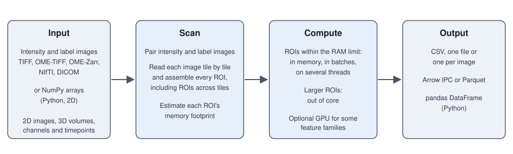

Nyxus
=====

Nyxus computes intensity, texture, morphology and image quality features for every region of
interest (ROI) in 2D images and 3D volumes: 758 features in all, 539 for 2D images, 213 for 3D
volumes and 6 image quality features. It runs from the command line or from Python, reads
TIFF, OME-TIFF, OME-Zarr, NIfTI and DICOM files (OME-TIFF and OME-Zarr with up to five
dimensions), and assembles ROIs that span several image tiles.

ROIs larger than the memory budget are processed out of core when they come from files; which
features then keep their in-memory values is listed under :ref:`large-images`.

.. grid:: 1 2 2 2
   :gutter: 3

   .. grid-item-card:: User guide
      :link: user_guide
      :link-type: doc

      How to install and run Nyxus, choose features, read and write each format, process 3D
      volumes and large images, use the GPU, IBSI mode, image quality features and the WIPP
      plugin, and fix common errors.

   .. grid-item-card:: Feature reference
      :link: feature_reference
      :link-type: doc

      Every feature code, feature group and definition, how features are validated, and the
      conventions they share.

   .. grid-item-card:: API reference
      :link: api_reference
      :link-type: doc

      The Python classes and functions, and every command-line option.

   .. grid-item-card:: Developer guide
      :link: developer_guide
      :link-type: doc

      Add a feature and work on the Nyxus code.

Citing Nyxus
------------

If you use Nyxus in your work, please cite the software. The citation metadata is kept in
``CITATION.cff`` at the repository root, and GitHub's *Cite this repository* button on the
`repository page <https://github.com/PolusAI/nyxus>`_ produces APA and BibTeX from it.

.. parsed-literal::

   Kharchenko, A. *Nyxus* (version |release|). https\://github.com/PolusAI/nyxus

.. parsed-literal::

   @software{nyxus,
     author  = {Kharchenko, Andriy},
     title   = {Nyxus},
     version = {|release|},
     url     = {https\://github.com/PolusAI/nyxus},
     license = {MIT}
   }

.. toctree::
   :hidden:

   user_guide
   feature_reference
   api_reference
   developer_guide
   release_notes
